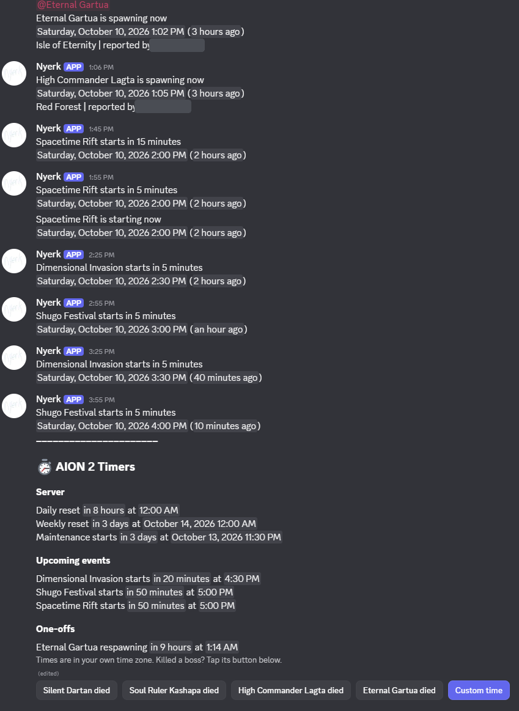
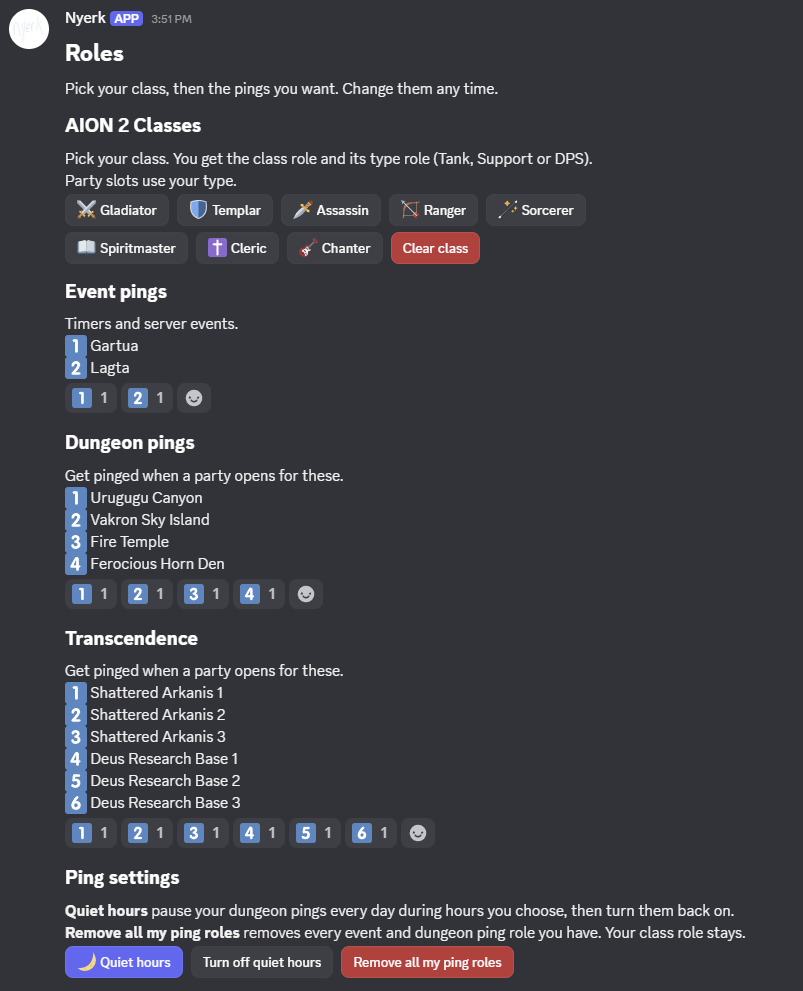
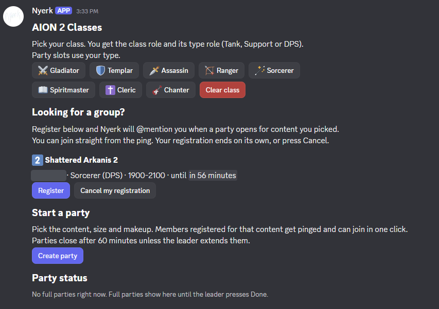
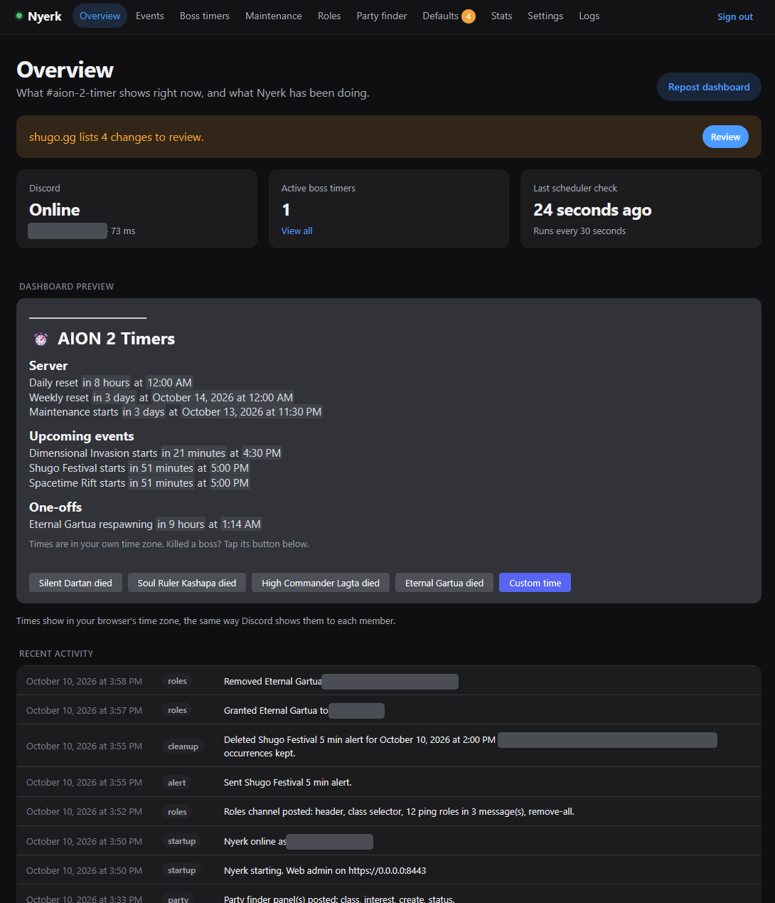

# Nyerk

**AION 2 event timers and party finder for Discord**, configured from a password-protected web admin on your LAN. Built for one server (NA East, Siel, Elyos).

**Timers** (#aion-2-timer)
- Plain-text alerts with optional role pings for scheduled events, world boss respawns, resets and maintenance.
- A live dashboard, always the newest message, with one-click world boss kill reports.
- Reaction roles in #aion-2-roles, grouped into role messages you define, plus a class selector and a one-click Remove all pings button. Activity is logged to #logs.

**Party finder** (#aion-2-party-finder)
- A class selector that hands out class and Tank/Support/DPS roles.
- An interest list that pings registered members when a matching party opens.
- 5 or 20 person party listings with join, leave, kick, extend, and a shared party status message.
- **Quiet hours**: members pick a daily window (in their own time zone) when their dungeon ping roles are paused, then given back.
- A **Stats** page: class distribution, content demand, party activity by day and hour, and the most active members.

## Screenshots

| | |
|---|---|
|  |  |
| **Timers:** alerts with role pings, then the dashboard with one-click boss reports | **Roles channel:** class selector, event and dungeon ping roles, quiet hours |
|  |  |
| **Party finder:** class picker, interest list, create party, party status | **Web admin:** bot status, dashboard preview and recent activity |

No channel or role IDs are in this repository. Set them in the admin page, or import them (see **Settings export and import** below).

## Quick start

No coding needed. You need a computer or server that stays on and has [Docker](https://docs.docker.com/get-docker/) installed, and admin rights on your Discord server. Plan on about 20 minutes.

**1. Create the bot in Discord**

1. Go to the [Discord Developer Portal](https://discord.com/developers/applications) and click **New Application**. Name it (for example Nyerk).
2. Open **Bot**, click **Reset Token** and copy the token. Treat it like a password: never share it or post it anywhere.
3. Open **General Information** and copy the **Application ID**.
4. Invite the bot by opening this link with your Application ID pasted in, then pick your server:
   `https://discord.com/oauth2/authorize?client_id=YOUR_APPLICATION_ID&scope=bot+applications.commands&permissions=2415995968`

**2. Get your server's IDs**

In Discord, open **User Settings → Advanced** and turn on **Developer Mode**. Now you can right-click things and choose **Copy ID**. Copy:
- your **server** (right-click the server icon),
- the channels you want to use for timers, reaction roles, logs and the party finder.

**3. Start Nyerk**

Make a folder, open a terminal in it, and run:

```bash
curl -O https://raw.githubusercontent.com/zle3/nyerk/main/compose.yaml
```

In the same folder, create a file named `.env` with these three lines, filled in:

```
DISCORD_TOKEN=paste-your-bot-token
GUILD_ID=paste-your-server-id
ADMIN_PASSWORD=pick-a-long-password
```

Then start it:

```bash
docker compose up -d
```

Using Dockge? Create a stack named `nyerk`, paste in the contents of `compose.yaml`, put the three lines in the env box, and click **Deploy**.

**4. Set it up in the web page**

1. Open `https://YOUR-COMPUTER-IP:8443` (type the `https://`). Your browser will warn about the certificate. That's expected, so accept it.
2. Sign in with your `ADMIN_PASSWORD`.
3. **Settings:** paste your channel IDs and click **Save settings**. The dashboard appears in your timer channel within a minute.
4. **Roles:** create roles in Discord for the pings you want (World Boss, Shugo, and so on), paste their IDs here, then click **Post roles channel**.
5. **Party finder** (optional): paste your class role IDs, add the dungeons people group for under **Content**, click **Create missing roles** so each dungeon gets a ping role, then **Post all panels** here and **Post roles channel** on the Roles page.

**5. Finish the Discord side**

- Drag Nyerk's role above every role it hands out (Server Settings → Roles).
- Make the timer and party finder channels read-only for members. Buttons still work.

That's it. Everything else, such as event times, alert toggles and message wording, can be changed in the web page at any time. The sections below cover the details.

## Run it

Every push to `main` runs the tests in GitHub Actions, builds the image and publishes it as `ghcr.io/zle3/nyerk:latest` (plus a `sha-xxxxxxx` tag, and `1.2.0`-style tags for `v1.2.0` git tags). The server only needs `compose.yaml`; it never sees the source.

### Dockge (or Portainer, Komodo, any compose manager)

1. In Dockge, **+ Compose**, name the stack `nyerk`, paste the contents of `compose.yaml`.
2. In the env editor set `DISCORD_TOKEN`, `GUILD_ID` and `ADMIN_PASSWORD`, then **Deploy**. Dockge pulls the image.
3. Open `https://<homelab-ip>:8443` (type the `https://`). The certificate is self-signed, so the browser asks you to accept it once. Behind an HTTPS reverse proxy, set `WEB_TLS=off` and point the proxy at port 8443.

**Private repo:** the image is private too, so the server must log in once: create a GitHub token (classic) with only `read:packages`, then on the server run `docker login ghcr.io -u zle3` and paste the token as the password. A public repo needs no login.

**Updating:** push to `main`, wait for the Actions run to go green (about 2 minutes), then click **Update** in Dockge. To update automatically, add a cron job on the server (`crontab -e`); it only restarts Nyerk when a new image was pulled:

```
*/15 * * * * cd /opt/stacks/nyerk && docker compose pull -q && docker compose up -d
```

**Rolling back / pinning:** set `NYERK_IMAGE=ghcr.io/zle3/nyerk:sha-abc1234` (or `:1.2.0`) in the env editor and Deploy.

On first start Nyerk seeds the ten launch events, the six categories and the three channel IDs from the scope doc. After that:

1. Create the category roles in Discord and paste each role ID on the **Roles** page.
2. Click **Post roles message**.
3. Check **Settings** and the **Events** alert toggles.

#### Data folder permissions

Data lands in `/opt/stacks/nyerk/data`. On start the container hands it to `PUID:PGID` (default 1000:1000) and drops root. If that can't work — the stack lives on an NFS/SMB share, SELinux blocks the mount, or chown is ignored — it logs a `nyerk-entrypoint:` line saying why and runs as root instead of crashing. To get back to non-root, either keep `data/` on a local disk, or on the host run `chown -R 1000:1000 /opt/stacks/nyerk/data`. On SELinux hosts (Fedora, RHEL, Rocky) change the volume to `./data:/data:z`.

### Build from source instead

```bash
cp .env.example .env        # fill in DISCORD_TOKEN, GUILD_ID, ADMIN_PASSWORD
docker compose -f compose.build.yaml up -d --build
```

### Settings export and import

**Settings → Export settings** downloads one JSON file with every setting, ping category, event, alert template and party finder list, IDs included. It never contains the admin password or the bot token. **Settings → Preview import** shows every change before anything is applied.

Import merges: rows are matched by name, and anything missing from the file is left alone. A short file that only sets IDs is enough:

```json
{
  "nyerk_export": 1,
  "settings": { "timer_channel_id": "…", "roles_channel_id": "…", "log_channel_id": "…", "party_channel_id": "…",
                "tank_role_id": "…", "support_role_id": "…", "dps_role_id": "…" },
  "categories": [ { "name": "World Boss", "role_id": "…" } ],
  "party_finder": { "classes": [ { "name": "Cleric", "role_id": "…" } ] }
}
```

`nyerk-settings*.json` is git-ignored, so keep your own copy next to the repo without committing it.

### Party finder setup

1. Settings: set **Party channel** and check the party timing values.
2. Party finder page: paste the Tank, Support and DPS role IDs and the class role IDs (or import them), and add the **content** (dungeons and activities) with their minimum gear score. Give each dungeon a ping role: paste an ID or click **Create role** (or **Create missing roles**). A new party pings that role and the members registered for it.
3. Create the Tank, Support and DPS roles in Discord yourself, and move Nyerk's role above all class and type roles.
4. Make #aion-2-party-finder read-only for members, then click **Post all panels**. Delete the old "AION 2 Classes" message by hand.
5. Roles page: click **Post roles channel**. Each role message (Event pings, Dungeon pings, and any you add) posts as its own message, numbered 1️⃣ 2️⃣ 3️⃣ (then 🇦 🇧 after 🔟) unless you set an emoji, continuing in a second message past 20. After them come a copy of the class selector and a **Remove all my ping roles** button. Choose which message each role goes in under **Which message each role goes in**.

### Discord setup

- **Bot invite scopes:** `bot` and `applications.commands`.
- **Permissions in the three channels:** View Channel, Send Messages, Read Message History, Add Reactions, Use Application Commands. Nyerk also needs Manage Roles, and its role must sit above every category role. It also needs Manage Messages in #aion-2-timer to delete old alerts and dashboards.
- **Role pings:** make each category role mentionable, or give Nyerk Mention All Roles.
- **Intents:** none of the privileged ones; Nyerk uses guilds and guild reactions only.
- **Channel:** make #aion-2-timer read-only for members. Buttons and slash commands still work.

## What's where

| Path | Purpose |
| --- | --- |
| `nyerk/schedules.py` | Schedule types (hourly, daily, every N hours, weekly, monthly, one-off, kill-reported). Each type answers "next occurrence after T". To add a type, subclass `ScheduleType` and decorate it with `@register`; the admin form builds itself from `fields`. |
| `nyerk/engine.py` | Due alerts, skip-after-downtime, message templates, dashboard text, cleanup. Has no Discord code. |
| `nyerk/timers.py` | World boss reports, edits, cancels, duplicate and limit rules. |
| `nyerk/bot.py` | The only module that talks to Discord: 30 s scheduler, dashboard repost and buttons, the `/nyerk` commands, reaction roles, #logs. |
| `nyerk/shugo.py` | shugo.gg table parser and the review diff. Hand-edited fields are never overwritten. |
| `nyerk/housekeeping.py` | Nightly SQLite backup (04:00 server time), daily shugo.gg check, self-signed cert. |
| `nyerk/web/` | FastAPI admin with server-rendered pages. |
| `data/` | `nyerk.db`, `backups/`, `logs/nyerk.log`, `tls/`. Back up by copying this folder. |

## Behaviour notes

- **Restarts:** alerts whose send time passed while Nyerk was down are skipped and logged to #logs. They are not sent late. The `sent_messages` ledger prevents double posts after a restart.
- **Kill reports:** a report with no time assumes the kill happened 5 minutes ago (the offset is editable). A `respawns_in` report uses the remaining time exactly as given. Warnings that are already in the past when a timer is reported are skipped silently.
- **Time zones:** each event stores its own time zone. Game events keep their New York hour, while resets and maintenance stay pinned to UTC, so their New York time moves an hour earlier on November 1. Tests cover both cases.
- **Maintenance overrides:** an override replaces one week's regular window. Emergency windows are added on top of the regular schedule.
- **Message templates:** a line containing only `{role}` is dropped when that slot's ping is off. Reporters are shown by display name, and user mentions are always disabled.

## Develop

```bash
uv venv -p 3.12 .venv && uv pip install --python .venv/bin/python -r requirements-dev.txt
.venv/bin/python -m pytest -q
NYERK_WEB_ONLY=1 ADMIN_PASSWORD=devpassword .venv/bin/python -m nyerk   # admin page without Discord
```
