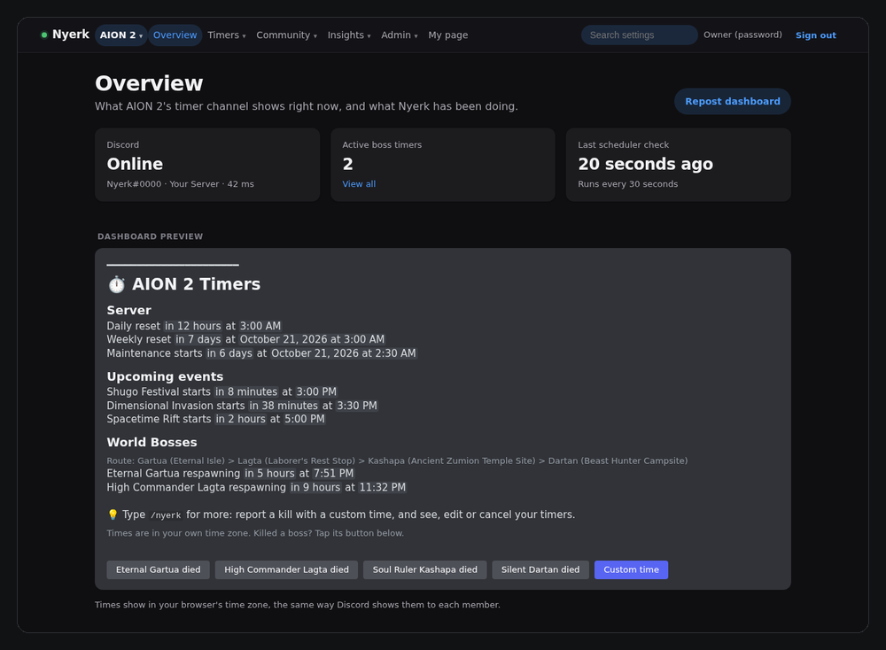
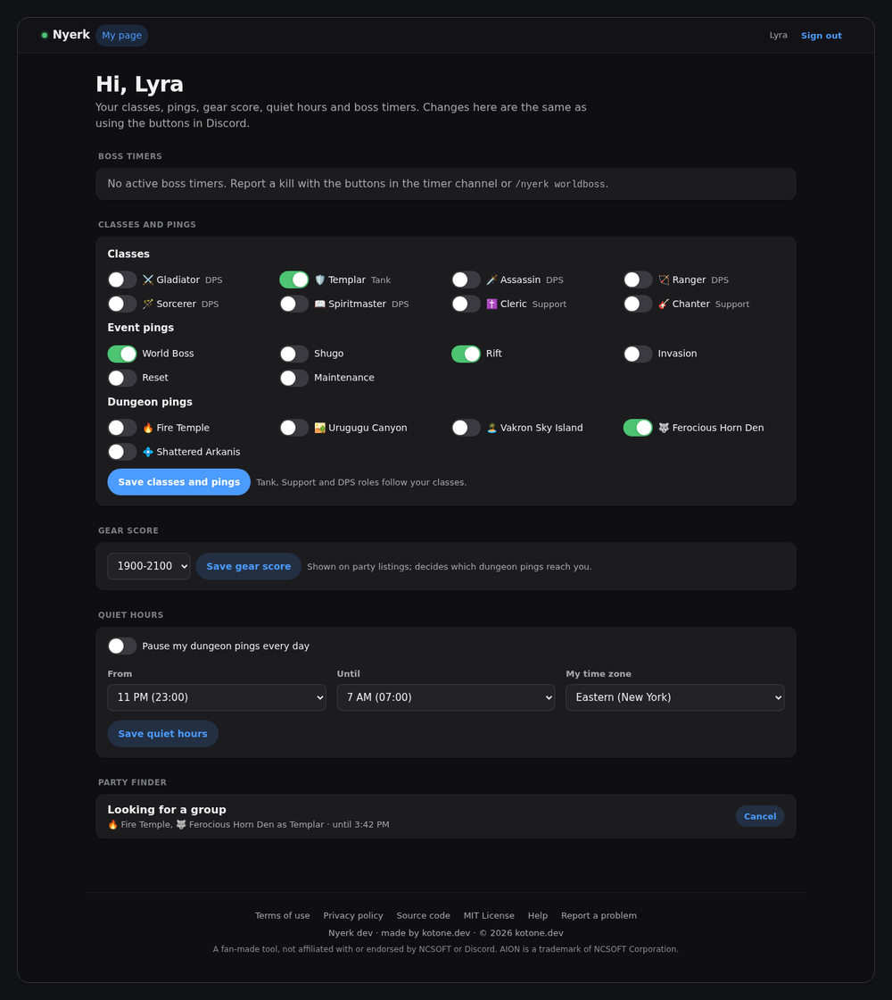
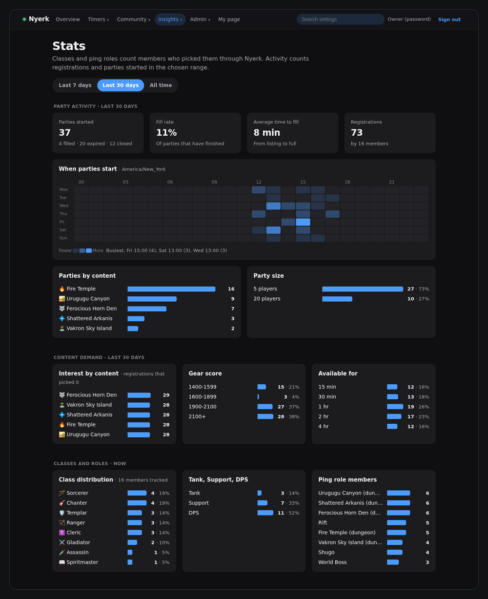
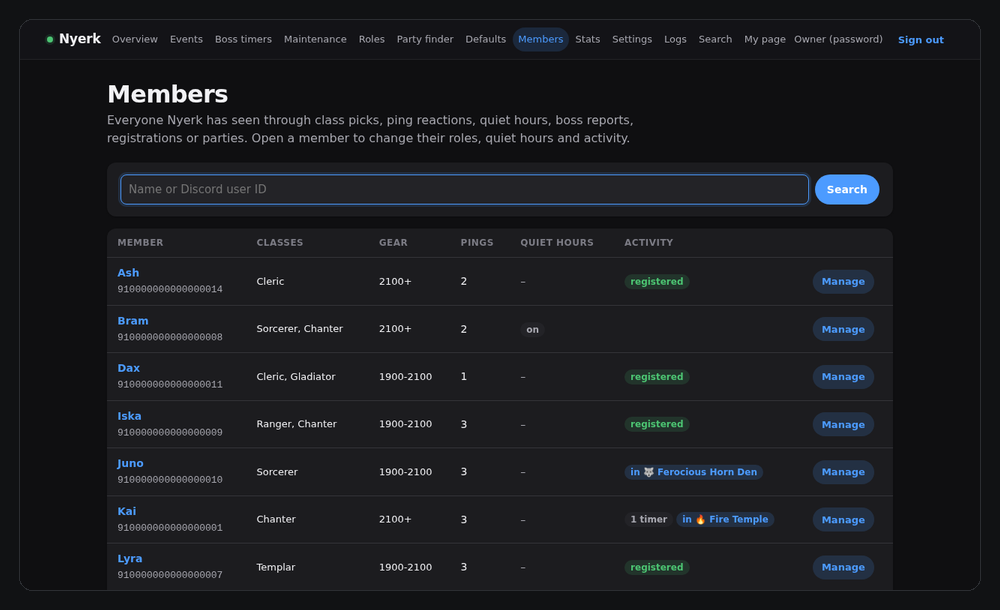
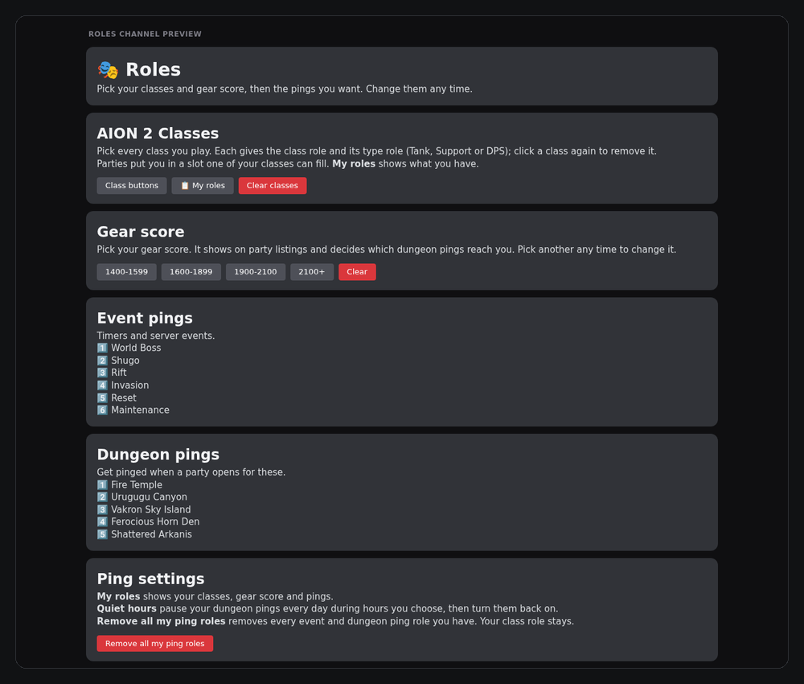
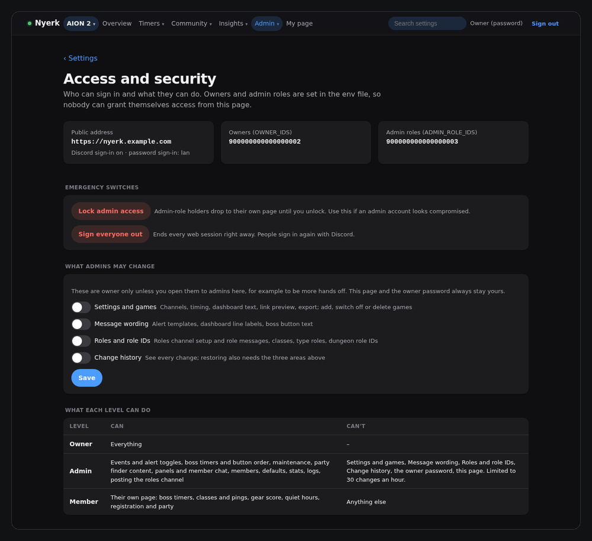

# Nyerk

**AION 2 event timers, roles and party finder for Discord.** One bot for one server (built for NA East, Siel, Elyos), set up from its own web page. Run it at home; optionally open the web page to your members at your own domain.

**Timers** (#aion-2-timer)
- Alerts with optional role pings for scheduled events, world boss respawns, resets and maintenance.
- A live dashboard, always the newest message, with one-click world boss kill reports.

**Roles** (#aion-2-roles)
- Self-serve reaction roles for event and dungeon pings, grouped into role messages you define and numbered 1️⃣ 2️⃣ 3️⃣.
- Class buttons (several classes per member, with Tank/Support/DPS roles that follow) and gear score buttons.
- **My roles** overview, **Quiet hours** that pause dungeon pings during a daily window in each member's own time zone, and a one-click **Remove all my ping roles**.

**Party finder** (#aion-2-party-finder)
- An interest list that pings registered members when a matching party opens.
- 5 or 20 person party listings with join, leave, kick, extend, and a shared party status message.

**Web page**
- Everything above is configured here: events, alerts and their wording, roles, party finder content, maintenance windows.
- **Members** page to manage one person in one place, **Stats** (class distribution, content demand, busiest times, most active members), change history with undo.
- Optional **public access** through a Cloudflare Tunnel with Discord sign-in, including a **My page** where members manage their own timers, roles, gear score and quiet hours.

## Contents

- [Screenshots](#screenshots)
- [Quick start](#quick-start)
- [Setup checklist](#setup-checklist)
- [How members use it](#how-members-use-it)
- [Running and updating](#running-and-updating)
- [Settings export and import](#settings-export-and-import)
- [Public access (Cloudflare Tunnel + Discord sign-in)](#public-access-cloudflare-tunnel--discord-sign-in)
- [Security updates](#security-updates)
- [Reference](#reference): [Discord permissions](#discord-permissions) · [Behaviour notes](#behaviour-notes) · [What's where](#whats-where) · [Develop](#develop)

## Screenshots

Generated from a demo instance with made-up members (`python -m tools.screenshots`), and refreshed automatically when the code changes.

### In Discord

**Timer channel:** alerts with role pings, then the live dashboard with one-click boss reports.


**Roles channel:** class buttons, event and dungeon ping roles, and ping settings (My roles, quiet hours).


**Party finder:** class picker, interest list, create party and party status.


### Web page

**Overview:** bot status and a live preview of the dashboard.



**My page:** what members see after signing in with Discord.



<details>
<summary><b>More: stats, members, roles setup, access and security</b></summary>

**Stats:** party activity by day and hour, content demand and class distribution.



**Members:** everyone Nyerk has seen, with their classes, gear score and activity.



**Roles:** a preview of the whole roles channel before posting it.



**Access and security:** who can sign in, what each level may do, and the emergency switches.



</details>

## Quick start

No coding needed. You need a computer or home server that stays on, with [Docker](https://docs.docker.com/get-docker/) installed, and admin rights on your Discord server. Plan on about 20 minutes.

**1. Create the bot**

1. Go to the [Discord Developer Portal](https://discord.com/developers/applications) → **New Application**, name it (for example Nyerk).
2. **Bot** → **Reset Token** → copy the token. Treat it like a password: never share it.
3. **General Information** → copy the **Application ID**.
4. Invite the bot: open this link with your Application ID pasted in, and pick your server.
   `https://discord.com/oauth2/authorize?client_id=YOUR_APPLICATION_ID&scope=bot+applications.commands&permissions=2415995968`

**2. Prepare your Discord server**

1. Turn on **User Settings → Advanced → Developer Mode**, so you can right-click anything → **Copy ID**.
2. Make four channels (any names): timers, roles, logs, and party finder (optional). Make the timer and party finder channels **read-only** for members; buttons and commands still work there.
3. Make the roles members will pick: one per event they want pings for (World Boss, Shugo, Rift, …), each set to **Allow anyone to @mention this role**. For the party finder, also one per class and Tank, Support and DPS.
4. In **Server Settings → Roles**, drag **Nyerk's role above all of those**, or it can't hand them out.

**3. Start Nyerk**

Make a folder and open a terminal in it. Download the compose file:

```bash
curl -O https://raw.githubusercontent.com/zle3/nyerk/main/compose.yaml
```

Create a file named `.env` in the same folder:

```
DISCORD_TOKEN=paste-your-bot-token
GUILD_ID=paste-your-server-id
ADMIN_PASSWORD=pick-a-long-password
```

Start it:

```bash
docker compose up -d
```

*Using Dockge?* Create a stack named `nyerk`, paste in the contents of `compose.yaml`, put the three lines in the env box, and click **Deploy**.

**4. Set it up in the web page**

1. Open `https://YOUR-COMPUTER-IP:8443` (type the `https://`). Your browser warns about the certificate; that's expected, so continue.
2. Sign in with your `ADMIN_PASSWORD`.
3. **Settings:** paste your channel IDs → **Save settings**. Within a minute the dashboard appears in your timer channel.
4. **Roles:** paste the role ID next to each event category and click **Save** on that row. When they're all in, click **Post roles channel**.
5. **Party finder** (optional): paste the class role IDs (**Save classes**) and the Tank, Support and DPS role IDs (**Save**). Add the dungeons people group for under **Content**, click **Create missing roles**, then **Post all panels**. Back on **Roles**, click **Post roles channel** again so the dungeon roles appear.

**5. Check it works**

The dashboard is in your timer channel, #logs says *Nyerk online*, and clicking a boss button on the dashboard gives you a private "Timer set" reply. (Remove that test timer with `/nyerk cancel`.)

That's it. Event times, alert toggles, message wording and everything else can be changed in the web page whenever you like.

## Setup checklist

The full list behind the Quick start, for reference. *Optional* items can be skipped.

**Discord**
- [ ] Bot created and invited with the Quick start link (it includes every permission Nyerk needs)
- [ ] Timer, roles, logs and party finder channels; timer read-only for members, party finder open for chat (Nyerk deletes members' messages after 15 minutes)
- [ ] Ping roles for the events you want, each mentionable
- [ ] Class roles and Tank, Support and DPS roles (party finder)
- [ ] Nyerk's role above every role it hands out
- [ ] Manage Messages for Nyerk in the party finder channel, so it can delete old chat
- [ ] *Optional:* Manage Messages for Nyerk in the roles channel, so **Remove all my ping roles** also clears members' reactions

**Server**
- [ ] `DISCORD_TOKEN`, `GUILD_ID` and `ADMIN_PASSWORD` in `.env` (or Dockge's env box)
- [ ] *Optional:* `WEB_TLS=off` behind your own HTTPS reverse proxy; `PUID`/`PGID` if the data folder must belong to a specific host user

**Web page**
- [ ] **Settings:** the four channel IDs; server time zone (default America/New_York)
- [ ] **Roles:** a role ID for each event category, then **Post roles channel**
- [ ] **Party finder:** class and Tank/Support/DPS role IDs, content with minimum gear score, dungeon roles (paste IDs or **Create missing roles**), then **Post all panels**
- [ ] **Events / Maintenance:** check boss respawn times, which alerts send and ping, and the weekly maintenance window
- [ ] *Optional:* the shugo.gg suggestions on **Defaults** (Artifact Siege, Siege Bosses, Nahma, Watcher Kaira), message wording, dashboard headings, party timings, gear score options
- [ ] *Optional:* import a settings file instead of typing IDs (**Settings → Export and import**)

On first start Nyerk already has the ten launch events, six ping categories, eight classes, the gear score options and availability windows. No channel or role IDs are built in; you add your own.

## How members use it

**Timer channel**
- The **dashboard** (always the newest message) shows resets, maintenance, upcoming events and world boss timers, in each reader's own time zone.
- Killed a world boss? Click its **"… died"** button. **Custom time** reports a kill from earlier, or the time left on a respawn.
- `/nyerk worldboss` does the same from the keyboard; `/nyerk mytimers`, `/nyerk edit` and `/nyerk cancel` manage your own timers. Reporting a boss you already reported replaces your timer; if someone else reported it, Nyerk asks before overriding theirs.

**Roles channel** (top to bottom)
- **Classes:** pick every class you play; click again to remove one.
- **Gear score:** one choice; pick another to change it.
- **Event pings** and **Dungeon pings:** react with the number to get that role; remove the reaction to drop it.
- **Ping settings:** **My roles** (a private overview), **Quiet hours** (pause dungeon pings every day during hours you choose), **Remove all my ping roles**.

**Party finder channel**
- **Register** to say you're free for certain dungeons for a while; Nyerk pings you when a matching party opens, and you can join from the ping.
- **Create party** for 5 or 20 players (open to any class, a standard 1 tank / 1 support / 3 DPS, or a custom makeup). Members join with one click; the leader can kick, extend or close it, and gets a private note whenever someone joins or leaves (a hidden message in the channel if they clicked something there in the last 15 minutes, otherwise a DM). Full parties move to the **Party status** message.
- **Chat** in the channel to plan runs. Messages are deleted after 15 minutes, and the **Party status** message says so. Admins change the time (or turn it off) on the web page under **Party finder → Member chat**; pinned messages stay.

**Web page** (with public access): **My page** lets members do all of the above from a browser after signing in with Discord.

## Running and updating

The image is built by GitHub Actions and published as `ghcr.io/zle3/nyerk:latest`; your server only needs `compose.yaml`.

- **Update:** click **Update** in Dockge, or `docker compose pull && docker compose up -d`. To update automatically, add a cron job on the server (`crontab -e`); it only restarts Nyerk when there's a new image:
  ```
  */15 * * * * cd /opt/stacks/nyerk && docker compose pull -q && docker compose up -d
  ```
- **Roll back or pin a version:** set `NYERK_IMAGE=ghcr.io/zle3/nyerk:sha-abc1234` (or a `weekly-YYYYMMDD` tag) in the env and deploy.
- **Your data** lives in the `data/` folder next to `compose.yaml`: the database, nightly backups (04:00 server time, last 14 kept), logs and the web page's certificate. Back up by copying that folder.
- **Data folder permissions:** on start the container hands `data/` to `PUID:PGID` (default 1000:1000) and stops running as root. If that can't work (an NFS/SMB share, SELinux, or ownership changes ignored), it logs a `nyerk-entrypoint:` line saying why and runs as root instead of failing. To fix it, keep `data/` on a local disk or run `chown -R 1000:1000 data` on the host; on SELinux hosts (Fedora, RHEL, Rocky) change the volume to `./data:/data:z`.
- **Forgot the password?** Add `NYERK_RESET_PASSWORD=1` and a new `ADMIN_PASSWORD` to the env, deploy, then remove `NYERK_RESET_PASSWORD`.
- **Private fork?** A private repo makes the image private too: create a GitHub token (classic) with only `read:packages` and run `docker login ghcr.io` once on the server.
- **Build from source instead:**
  ```bash
  cp .env.example .env        # fill in DISCORD_TOKEN, GUILD_ID, ADMIN_PASSWORD
  docker compose -f compose.build.yaml up -d --build
  ```

## Settings export and import

**Settings → Export settings** downloads one JSON file with every setting, ping category, event, alert template, role message and party finder list, channel and role IDs included. It never contains the admin password or any token. **Settings → Preview import** shows every change before anything is applied.

Import merges: rows are matched by name, and anything missing from the file is left alone. A short file that only sets IDs is enough:

```json
{
  "nyerk_export": 1,
  "settings": { "timer_channel_id": "…", "roles_channel_id": "…", "log_channel_id": "…", "party_channel_id": "…",
                "tank_role_id": "…", "support_role_id": "…", "dps_role_id": "…" },
  "categories": [ { "name": "World Boss", "role_id": "…" } ],
  "party_finder": { "classes": [ { "name": "Cleric", "role_id": "…" } ] }
}
```

`nyerk-settings*.json` is git-ignored, so you can keep your own copy next to the repo without committing it.

## Public access (Cloudflare Tunnel + Discord sign-in)

Optional. People open Nyerk at your own domain; no port is opened on your router and your home IP stays hidden. Everyone signs in with Discord, so there are no accounts or passwords to hand out.

| Who | How | Can |
|---|---|---|
| **Owner** | Your Discord user ID in `OWNER_IDS`, or the owner password on your LAN | Everything |
| **Admin** | Holds a role in `ADMIN_ROLE_IDS` (checked again every 5 minutes) | Events and alert toggles, boss timers and button order, maintenance, party finder content, panels and member chat, members, defaults, stats, logs, posting the roles channel. Not message wording, role IDs, roles channel setup, classes, Settings, export/import or history, unless you open them (below). 30 changes an hour. |
| **Member** | Anyone in your server | **My page**: their boss timers, classes and pings, gear score, quiet hours, registration and party |

**Hands off?** On **Settings → Access and security → What admins may change**, open any of the owner-only areas to admins: **Settings**, **Message wording**, **Roles and role IDs**, **Change history**. Importing a settings file also needs the first three, and restoring from history needs all four. The Access page and the owner password always stay yours, and an import or restore can never change who may do what.

**1. Your domain on Cloudflare.** Add the domain at [dash.cloudflare.com](https://dash.cloudflare.com) (Free plan) and switch its nameservers at your registrar to the two Cloudflare gives you. Wait until it shows **Active**.

**2. Discord sign-in.** In the [Developer Portal](https://discord.com/developers/applications) → your app → **OAuth2**, add the redirect `https://nyerk.example.com/auth/callback` (your domain) and copy the **Client ID** and **Client Secret**.

**3. The tunnel.** In [Cloudflare Zero Trust](https://one.dash.cloudflare.com) → **Networks → Tunnels** → **Create a tunnel** (Cloudflared), and copy the token from the Docker command it shows (the part after `--token`). Add a **published application**: `nyerk` + your domain → Service URL **`http://nyerk:8080`**. That port is plain HTTP inside the stack only and is never published; visitors still get HTTPS from Cloudflare.

**4. Env.** Add to the stack's env and deploy:

```
PUBLIC_URL=https://nyerk.example.com
DISCORD_CLIENT_ID=…
DISCORD_CLIENT_SECRET=…
OWNER_IDS=your-discord-user-id
ADMIN_ROLE_IDS=role-id-of-your-admins
COMPOSE_PROFILES=tunnel
TUNNEL_TOKEN=…
WEB_BIND=127.0.0.1:8443   # optional: stop publishing the port on your LAN
```

Check: the stack shows a `nyerk-tunnel` container, the **nyerk** log says *Tunnel listener on http://nyerk:8080*, and your address shows the sign-in page.

| Problem | Fix |
|---|---|
| No `nyerk-tunnel` container | `COMPOSE_PROFILES=tunnel` missing, or an old `compose.yaml`; paste the current one |
| `nyerk-tunnel` warns *Group ID 65532 is not between ping group* / *ICMP proxy feature is disabled* | Harmless (it only affects ping through the tunnel, not the website). The current `compose.yaml` silences it; paste it and redeploy |
| 502 Bad Gateway, log says *connection refused* | `PUBLIC_URL` not set, or an old `compose.yaml` that doesn't pass it to Nyerk |
| Error 1033 | The tunnel container isn't running, or the token is incomplete |
| Discord: *Invalid OAuth2 redirect_uri* | The redirect and `PUBLIC_URL` must match exactly, including `https://` |

**5. Cloudflare protection** (free plan, your domain's dashboard):
- **Security → WAF → Rate limiting rules:** when *URI Path* starts with `/auth` or `/login`, 10 requests per 1 minute per IP → **Block** for 10 minutes.
- **Security → Bots:** turn on **Bot Fight Mode**.
- **Security → Settings:** keep *Security Level* at Medium; switch on **I'm Under Attack** if you're ever flooded.

**6. Keep the containers off your LAN** (recommended, Linux host). Even if someone found a hole in Nyerk, the container can't reach your router, NAS or other machines. Replace `192.168.0.0/16` with your LAN range:

```bash
sudo iptables -I DOCKER-USER -s 172.30.70.0/24 -d 192.168.0.0/16 -m conntrack --ctstate NEW -j DROP
sudo apt install iptables-persistent && sudo netfilter-persistent save   # keep it after reboots
```

**Already built in:** Discord sign-in reads only your name and ID and discards the token; sessions last 12 hours and are re-checked against your server roles; owner-only changes need a sign-in from the last hour; password sign-in is refused through Cloudflare; per-IP rate limits and a 2 MB request cap; strict security headers and HSTS; links, invites and @everyone/@here are refused in all text; every change is recorded in **Settings → Change history** with one-click restore and posted to #logs; the container runs read-only, as a normal user, with all privileges dropped.

**If an admin account looks compromised:** **Settings → Access and security → Lock admin access** (instant), then **Change history** to restore anything they changed, then remove their role in Discord.

Pasting your address in Discord shows a link preview; its title and text are under **Settings → Link preview**.

## Security updates

Mostly automatic:

- **Dependabot** opens weekly pull requests for the Python libraries (each pinned to an exact version in `requirements.txt`), the Python base image and the GitHub Actions; security fixes arrive as soon as GitHub knows about them. Merge the ones where CI is green.
- **CI** on every push and pull request runs the tests, `pip-audit` and a **Trivy** scan of the finished image. A fixable HIGH or CRITICAL issue fails the build, so it never gets published. Reports appear under the repo's **Security** tab.
- **Weekly rebuild:** every Monday the image is rebuilt from scratch with the latest Debian security updates and published as `latest` (plus `weekly-YYYYMMDD`), even with no code changes. Your update cron deploys it.
- **cloudflared:** a weekly job opens a pull request when Cloudflare releases a newer version (pinned in `compose.yaml`, or set `CLOUDFLARED_VERSION`). It doesn't run CI, so merge with **Merge without waiting for requirements**, then update the compose file in Dockge and deploy.
- **This repository** has Dependabot alerts and security updates, secret scanning with push protection, and a protected `main` that requires the **test** and **image** checks. For a fork, turn these on under the repo's **Settings**.
- **On the server:** keep the host patched (`sudo apt install unattended-upgrades` on Debian/Ubuntu) and update Docker and Dockge every month or two.

## Reference

### Discord permissions

- **Invite scopes:** `bot` and `applications.commands`.
- **In the four channels:** View Channel, Send Messages, Read Message History, Add Reactions, Use Application Commands.
- **Manage Roles,** with Nyerk's role above every role it hands out (ping, class, Tank/Support/DPS). Nyerk only creates roles when you click **Create role** for a dungeon.
- **Manage Messages** in the party finder channel, to delete members' chat once it is old enough, and in the roles channel, so **Remove all my ping roles** can clear members' reactions. Nyerk deletes its own messages without it.
- **Role pings:** make each ping role mentionable, or give Nyerk Mention All Roles. Nyerk never pings @everyone.
- **Intents:** none of the privileged ones; Nyerk uses guilds and guild reactions only.

### Behaviour notes

- **Restarts:** alerts whose send time passed while Nyerk was down are skipped and listed in #logs, not sent late. A sent-alerts ledger prevents double posts after a restart.
- **Parties during an update:** on stop, Nyerk finishes the Discord update it is in the middle of before exiting. Party and registration deadlines are paused while it is offline, so nobody loses time they couldn't use, and any party message left half-recorded is cleaned up on start. Buttons clicked while it restarts show "This interaction failed"; they work again as soon as Nyerk is back, usually within a minute.
- **Kill reports:** a report with no time assumes the kill happened 1 minute ago (Settings → **Report offset**). A "respawns in" report uses the time left exactly as given. Warnings already in the past when a timer is reported are skipped.
- **Alert cleanup:** alert messages are deleted 2 hours after their event starts or the boss spawns (Settings → **Delete alerts after**); alerts under an hour old are always kept.
- **Time zones:** each event stores its own time zone. Game events keep their New York hour, while resets and maintenance stay pinned to UTC, so their New York time moves an hour earlier on November 1.
- **Maintenance overrides:** an override replaces one week's regular window; emergency windows are added on top.
- **Message templates:** a line containing only `{role}` is dropped when that alert's ping is off. Reporters are shown by display name; timer alerts never mention users.
- **Who gets mentioned:** timer alerts ping only their category role. Party finder pings mention only the people they're for: matching registrants and the dungeon role for a new party, the leader for the closing warning, and the members when a party is full.
- **#logs vs the Logs page:** routine lines (scheduled alerts, cleanup, registrations expiring) stay on the web Logs page; reports, overrides, role changes, config changes and problems also go to #logs.
- **Data from shugo.gg:** Nyerk reads the shugo.gg timer table once a day and only suggests changes on **Defaults**; nothing changes until you approve it, and fields you edited are never overwritten.

### What's where

| Path | Purpose |
| --- | --- |
| `nyerk/schedules.py` | Schedule types (hourly, daily, every N hours, weekly, monthly, one-off, kill-reported). Each type answers "next occurrence after T". To add a type, subclass `ScheduleType` and decorate it with `@register`; the admin form builds itself from `fields`. |
| `nyerk/engine.py` | Due alerts, skip-after-downtime, message templates, dashboard text, cleanup. Has no Discord code. |
| `nyerk/timers.py` | World boss reports, edits, cancels, overrides and limit rules. |
| `nyerk/bot.py` | Discord side of timers and roles: 30 s scheduler, dashboard and its buttons, the `/nyerk` commands, the roles channel, quiet hours, #logs. |
| `nyerk/party.py` / `nyerk/party_bot.py` | Party finder rules (classes, gear score, slots, registrations, pings) and its Discord panels, buttons and forms. |
| `nyerk/reaction_roles.py` | Builds the roles channel's role messages and emoji numbering. |
| `nyerk/quiet.py` | Quiet hours: when to pause and restore dungeon ping roles. |
| `nyerk/members.py` / `nyerk/tracking.py` | The Members page, and the record of class and ping roles Nyerk has handed out. |
| `nyerk/stats.py` | Numbers for the Stats page. |
| `nyerk/transfer.py` / `nyerk/history.py` | Settings export and import; change history with restore. |
| `nyerk/safety.py` | The link/invite filter and the @everyone guard. |
| `nyerk/shugo.py` | shugo.gg table parser and the review diff. |
| `nyerk/housekeeping.py` | Nightly backup, daily shugo.gg check, self-signed certificate. |
| `nyerk/web/` | The web page (FastAPI, server-rendered); `auth.py` decides who may do what, `security.py` handles rate limits, headers and Cloudflare client IPs. |
| `data/` | `nyerk.db`, `backups/`, `logs/nyerk.log`, `tls/`. |

### Develop

```bash
uv venv -p 3.12 .venv && uv pip install --python .venv/bin/python -r requirements-dev.txt
.venv/bin/python -m pytest -q
NYERK_WEB_ONLY=1 ADMIN_PASSWORD=devpassword .venv/bin/python -m nyerk   # web page without Discord
```

Screenshots in `docs/images` come from `tools/screenshots.py`: it builds a demo database (fake members and IDs, fixed clock), renders the Discord channels from Nyerk's real message code and photographs the web pages with Playwright. The **Screenshots** workflow runs it after each change on `main` and opens a pull request when an image changes. To run it locally:

```bash
uv pip install --python .venv/bin/python -r requirements-screenshots.txt
.venv/bin/python -m playwright install chromium
.venv/bin/python -m tools.screenshots docs/images
```
